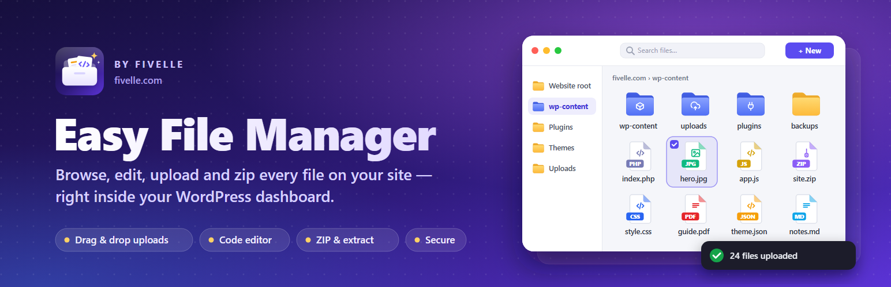

  

<h1 align="center">Easy File Manager</h1>

  An easy, secure file manager for your whole WordPress website. 
  Browse, upload, edit, preview, zip and manage every file, right inside the dashboard. 
  Built by <a href="https://fivelle.com/?utm_source=github&utm_medium=readme&utm_campaign=easy-file-manager"><strong>Fivelle</strong></a>.

  <a href="https://github.com/farooqmarwat1/easy-file-manager/releases/latest/download/easy-file-manager.zip"><strong>⬇ Download the latest version</strong></a>
  &nbsp;·&nbsp;
  <a href="https://github.com/farooqmarwat1/easy-file-manager/releases">Releases</a>
  &nbsp;·&nbsp;
  <a href="https://github.com/farooqmarwat1/easy-file-manager/issues">Report a problem</a>

---

## Features

**Browse**
- Folder tree, breadcrumbs, back / forward / up
- Grid view with live image thumbnails, or a detailed list view
- 70+ colour-coded file-type icons, plus special icons for WordPress folders
- Instant filter, and search through every subfolder
- Quick access to the site root, `wp-content`, plugins, themes and uploads
- Storage meter with disk usage, PHP / WordPress version and upload limit

**Manage**
- Drag & drop uploads (files *and whole folders*) with progress bars
- New file / folder, rename, duplicate, delete
- Copy, cut, paste, or drag items onto folders to move them
- Compress to ZIP, extract ZIP (protected against "zip slip")
- Download a file, or many files and folders as one ZIP
- Change permissions (chmod) with a visual read / write / execute grid

**Edit & preview**
- Built-in code editor with syntax highlighting (PHP, JS, CSS, HTML, JSON, SQL, Markdown, YAML…)
- `Ctrl + S` to save, unsaved-changes warning, and a warning if the file changed on the server
- Full-screen previews for images, video, audio and PDF

**Comfort**
- Right-click menus, keyboard shortcuts (press `?`), light and dark themes
- Details panel: size, dimensions, permissions, owner, server path, public URL
- Activity log of every change
- One-click updates from GitHub releases, straight from your Plugins screen

## Installation

1. Download **[easy-file-manager.zip](https://github.com/farooqmarwat1/easy-file-manager/releases/latest/download/easy-file-manager.zip)**.
2. In WordPress, go to **Plugins → Add New → Upload Plugin**, choose the ZIP and click **Install Now**.
3. Activate it, then open **File Manager** in the admin menu.

New versions show up on your **Plugins** screen like any other update.

## Security

- Only administrators can use it (Super Admins on multisite), optionally limited to a list of usernames.
- Every request is checked with a WordPress nonce and a capability check.
- All paths are resolved on the server and locked to the root folder you choose; `..`, outside symlinks and absolute paths are rejected.
- Read-only mode, also switched on automatically when `DISALLOW_FILE_MODS` is set.
- Lock the root folder from code: `define( 'FIVELLE_FE_ROOT', '/path/to/folder' );` in `wp-config.php`.

A file manager is a powerful tool: anyone with access can change any file on the site. Keep administrator accounts secure and consider read-only mode on production sites.

## Requirements

- WordPress 5.8 or newer
- PHP 7.4 or newer
- PHP Zip extension for ZIP features

## Releasing a new version (maintainers)

1. Bump `Version:` in `easy-file-manager.php`, `FIVELLE_FE_VERSION`, and `Stable tag:` in `readme.txt`.
2. Commit and push.
3. Create a GitHub release with a tag such as `v1.0.1`. A GitHub Action builds `easy-file-manager.zip` and attaches it to the release, and sites get the update automatically.

## About Fivelle

Easy File Manager is developed by **[Fivelle](https://fivelle.com/?utm_source=github&utm_medium=readme&utm_campaign=easy-file-manager)**: websites, WordPress plugins and custom web solutions for businesses.
Maintained by [Muhammad Farooq](https://profiles.wordpress.org/farooqmarwat/) · [LinkedIn](https://www.linkedin.com/in/thefarooqkhan).

## License

GPL-2.0-or-later. See [LICENSE](LICENSE).
